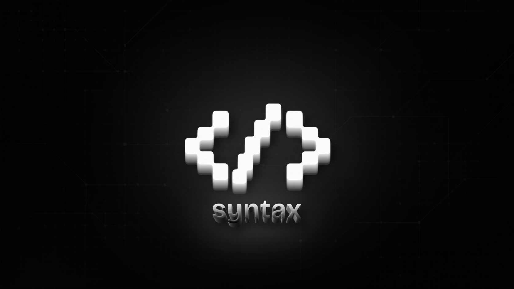

<p align="center"></p>

<h1 align="center">syntax</h1>
<p align="center"><strong>local inference, engineered from the ground up.</strong><br>An experimental native inference engine and terminal coding agent.</p>

> [!IMPORTANT]
> **Early development / research.** Syntax is not yet a complete, runnable LLM inference engine. Performance targets are hypotheses, not verified results.

## Overview

**Syntax** combines two related projects: a low-level, local-first LLM inference runtime and a purpose-built terminal coding agent. The engine aims to explore efficient model execution on constrained hardware, particularly with mixture-of-experts (MoE) models, memory management and GPU kernels. The agent will provide a native, keyboard-driven way to work with local models and code.

**The research question:** Can careful scheduling, memory hierarchy design, expert residency and exact execution techniques make huge local models practical without compromising model quality?

## Stack

| Layer | Technologies | Planned responsibility |
|---|---|---|
| Native engine | C / C++ | Tensors, model loaders, sampling, KV cache, execution |
| GPU | CUDA, PTX, Triton | Kernels, profiling, attention and quantization experiments |
| CPU architecture | AArch64, x86-64 assembly | Targeted low-level experiments |
| Terminal agent | Go | Original TUI, sessions, code tools, streaming |
| Services | Bun, TypeScript, JavaScript | Plugins and agent tooling |
| Orchestration | Elixir / OTP | Concurrent workers, future distributed services |
| Research | Python | Benchmarks, compression, SSD offloading experiments |
| Databases | SQLite, PostgreSQL | Local sessions; future server-side data |
| Dashboard | React / TypeScript | Optional web interface |

SGLang is a **benchmark and integration reference**, not the implementation of the custom Syntax engine.

## Repository layout

```text
syntax/
├── assets/branding/            # logo variants and memory-lattice artwork
├── engine/{include,src,tests}/  # native inference core
├── gpu/{cuda,ptx,triton}/       # GPU experiments
├── asm/{aarch64,x86_64}/       # architecture-specific experiments
├── research/                   # benchmarks, compression, offloading
├── tui/                        # original Go terminal UI
├── services/                   # Bun / Go / Elixir integrations
├── python/                     # model utilities
├── db/{sqlite,postgres}/       # local and hosted persistence
└── docs/                       # architecture, roadmap, benchmarks
```

## Development

Code is developed on a NixOS desktop and GPU experiments run on an ASUS Ascent GX10 (NVIDIA GB10, AArch64). The runtime is not installable yet; early work involves building a correct C++ tensor foundation and CPU reference operations.

To syntax-check the initial tensor header after it exists:

```bash
printf '#include "engine/include/syntax/tensor.hpp"\nint main() { return 0; }\n' \
  | g++ -std=c++20 -Wall -Wextra -pedantic -x c++ -fsyntax-only -I. -
```

## Roadmap

- [x] Define scope and visual identity
- [x] Start research and development workspace
- [ ] Tested C++ tensor and memory fundamentals
- [ ] CPU reference matrix operations
- [ ] First custom CUDA kernels and profiler traces
- [ ] Load and decode a small real transformer
- [ ] Original Go TUI with streamed tokens
- [ ] Real expert-access traces and cache/offload experiments
- [ ] Compare correctness, quality and speed against SGLang / other baselines
- [ ] Experiment with larger MoE models

See [roadmap](docs/ROADMAP.md), [architecture](docs/ARCHITECTURE.md) and [benchmark methodology](docs/BENCHMARKING.md).

## Principles

**Correctness before speed · Evidence over promises · Local-first · Reproducibility · No fabricated benchmarks.**

## Contributing and license

See [CONTRIBUTING.md](CONTRIBUTING.md). MIT License, see [LICENSE](LICENSE).
